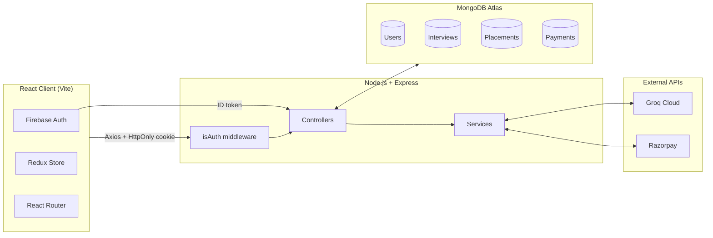
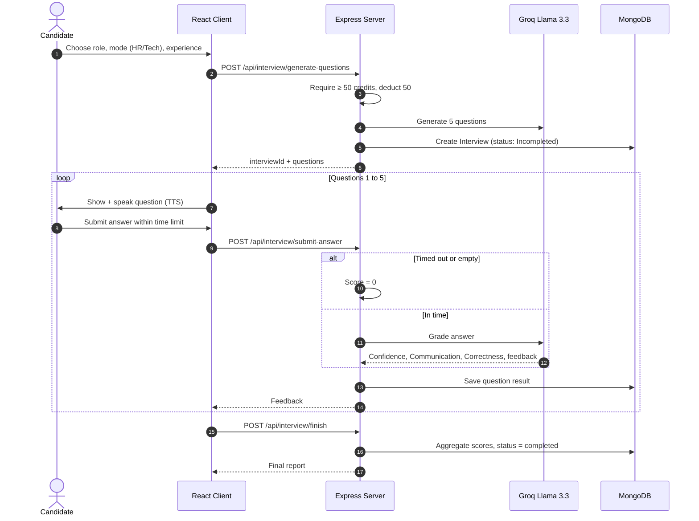
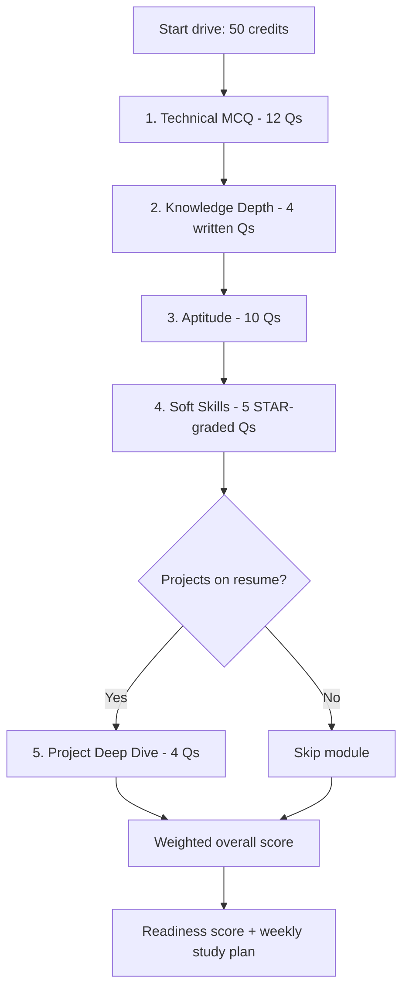

<div align="center">

# 🎯 WeWithYou

### AI-Powered Mock Interviews & Placement Preparation Platform

Practice timed HR and technical interviews, take a 5-module placement drive, check your resume against ATS, and get a personalized study roadmap, all in one workspace.

<p>
  
  
  
  
  
  
  
  
  
</p>

[Features](#-features) · [Tech Stack](#-tech-stack) · [Architecture](#-architecture) · [Quick Start](#-quick-start) · [API](#-api-reference) · [Deployment](#-deployment) · [Roadmap](#-roadmap)

</div>

---

## 📖 Overview

**wewithyou** is a full-stack platform that combines two career-readiness tracks in one place:

1. **AI Conversational Mock Interviews (HR & Technical)**: timed, voice-assisted sessions where questions are generated from your resume, target role, and experience level. You answer by typing or speaking, and every answer is graded instantly.
2. **Placement Mock Exam Drive**: a five-module corporate-style exam (Technical MCQs, Written Knowledge, Aptitude, Soft Skills, Project Deep Dive) that ends with a weighted readiness score and a week-by-week study plan.

## ⚠️ The Problem

| Problem | Why it hurts |
| :--- | :--- |
| **Expensive mentorship** | 1:1 coaching often costs $100+/hour, out of reach for most students. |
| **No real pressure** | Reading question lists doesn't simulate timed, interactive interviews. |
| **Opaque resume feedback** | Resume builders rarely show whether you'd actually pass an ATS or match a role. |
| **Narrow assessment** | Most platforms test only coding or MCQs, ignoring communication, confidence, and project depth. |

**wewithyou** fixes this with an automated, credit-based coach that reads your resume, runs timed sessions, and returns structured, metric-backed feedback in seconds.

---

## ✨ Features

| | Feature | Details |
| :-: | :--- | :--- |
| 🤖 | **AI Mock Interviews** | Context-aware HR / Technical questions generated by **Groq (Llama 3.3 70B)**; 5 timed questions per session; questions read aloud via Web Speech TTS. |
| 📄 | **Resume Parsing** | Upload a PDF; server-side **PDF.js** extracts text and the LLM structures role, skills, projects, education, and summary. |
| 📈 | **ATS Checker** | Match score against a target role, matched/missing keywords, and concrete bullet-point suggestions. |
| 🧠 | **Placement Drive** | 5 modules: Technical MCQ (12 Qs, 25 min), Knowledge Depth (4 Qs, 30 min), Aptitude (10 Qs, 20 min), Soft Skills (5 Qs, 20 min), Project Deep Dive (4 Qs, 15 min, auto-skipped if no projects). |
| 📊 | **3-Axis Evaluation** | Every answer scored on **Confidence**, **Communication**, and **Correctness**. |
| 🗺️ | **Learning Roadmaps** | Week-by-week tracks with milestone checklists and free learning resources. |
| 📥 | **PDF Reports** | Clean, resume-style performance reports exported client-side with **jsPDF + AutoTable**. |
| 💳 | **Credits & Payments** | 100 free credits on signup, 50 per session. Razorpay checkout with **HMAC-SHA256** signature verification. |
| 🔐 | **Secure Auth** | Google sign-in via Firebase, then a backend **JWT in an HttpOnly cookie**. |

---

## 🛠️ Tech Stack

**Frontend (`/client`)**

| Technology | Purpose |
| :--- | :--- |
| React 19 + Vite 7 | UI and build tooling |
| Tailwind CSS 4 | Styling and theming |
| Redux Toolkit 2 | Global state (user, credits, interview session) |
| React Router DOM 7 | Routing with route guards |
| Firebase 12 | Google SSO client |
| Axios | HTTP client with credentials |
| Recharts 3 | Radar / area score charts |
| Framer Motion 12 | Animations and transitions |
| jsPDF + AutoTable | Offline PDF report generation |

**Backend (`/server`)**

| Technology | Purpose |
| :--- | :--- |
| Node.js 18/20 + Express 5 | REST API |
| MongoDB Atlas + Mongoose 9 | Persistence and ODM |
| Groq SDK (Llama 3.3 70B) | Question generation and grading |
| Razorpay SDK 2 | Orders and payment verification |
| pdfjs-dist (legacy) 5 | PDF text extraction |
| Multer 2 | Multipart file uploads |
| jsonwebtoken 9 | Session tokens |

---

## 🏗️ Architecture



**Design highlights**

- **Decoupled client and server.** The frontend compiles to static assets; the API is fully headless.
- **Cookie-based sessions.** JWTs live in `HttpOnly` (and `Secure` in production) cookies, so they can't be read by XSS.
- **Strict JSON from the LLM.** Prompts demand JSON-only output, and a tolerant parser (`parseJsonArray`) recovers arrays even when the model wraps them in Markdown.
- **Separated services.** Uploading, PDF extraction, AI calls, and payments live in `services/`, away from route controllers.

### Authentication flow

```mermaid
sequenceDiagram
    autonumber
    actor C as Candidate
    participant App as React Client
    participant G as Firebase / Google
    participant S as Express Server
    participant DB as MongoDB

    C->>App: Click "Sign in with Google"
    App->>G: Open Google popup
    G-->>App: Firebase ID token
    App->>S: POST /api/auth/google { idToken }
    S->>G: Verify token
    S->>DB: Find or create user (100 credits on create)
    S-->>App: Set HttpOnly JWT cookie + user JSON
    Note over App,S: Later requests carry the cookie; isAuth sets req.userId
```

### Interview flow



### Placement drive flow



---

## 📁 Project Structure

```
wewithyou/
├── client/                         # React frontend (Vite)
│   ├── public/
│   └── src/
│       ├── assets/
│       ├── components/             # Navbar, Step1SetUp, Step2Interview, Step3Report,
│       │                           # Timer, Footer, AuthModel
│       ├── pages/                  # Home, Auth, InterviewPage, InterviewReport,
│       │                           # InterviewHistory, Pricing, Guidance, ResumeTips,
│       │                           # CompanyPrep, Roadmap, PlacementTestPage,
│       │                           # PlacementResultsPage
│       ├── redux/                  # store.js, userSlice.js, interviewSlice.js
│       ├── utils/                  # config, constants, endpoints
│       ├── App.jsx
│       ├── main.jsx
│       └── index.css
│
├── server/                         # Express backend
│   ├── config/connectDb.js
│   ├── controllers/                # auth, user, interview, resume,
│   │                               # questions, evaluate, payment
│   ├── middlewares/isAuth.js
│   ├── models/                     # user, interview, placement, payment
│   ├── routes/                     # auth, user, interview, resume,
│   │                               # questions, evaluate, placement, payment
│   ├── services/                   # groq, openRouter (backup LLM),
│   │                               # scorer, razorpay
│   ├── public/                     # Multer temp storage
│   ├── scratch/test_ai_questions.js
│   └── index.js
│
├── .gitignore
└── README.md
```

---

## 🚀 Quick Start

### Prerequisites

- Node.js **v18+** and npm
- A **MongoDB Atlas** connection string
- A **Groq API key** ([console.groq.com](https://console.groq.com))
- A **Firebase** project with Google sign-in enabled
- A **Razorpay** test account (key ID + secret)

### 1. Clone

```bash
git clone https://github.com/<your-username>/wewithyou.git
cd wewithyou
```

### 2. Configure environment variables

**`server/.env`**

```env
PORT=8000
MONGODB_URL=mongodb+srv://<username>:<password>@cluster0.xxxxx.mongodb.net/wewithyou?retryWrites=true&w=majority
JWT_SECRET=replace_with_a_long_random_string
GROQ_API_KEY=gsk_your_groq_api_key
GROQ_MODEL=llama-3.3-70b-versatile
RAZORPAY_KEY_ID=rzp_test_your_key_id
RAZORPAY_KEY_SECRET=your_razorpay_secret
```

**`client/.env`**

```env
VITE_FIREBASE_APIKEY=your_firebase_api_key
VITE_RAZORPAY_KEY_ID=rzp_test_your_key_id
```

> 🔒 Never commit `.env` files. Make sure they're listed in `.gitignore`.

### 3. Run the backend

```bash
cd server
npm install
npm run dev
```

Expected output: `Express API Server running on port 8000` and `MongoDB Atlas Connected Successfully`.

### 4. Run the frontend

```bash
cd client
npm install
npm run dev
```

Open **http://localhost:5173**.

---

## 🔌 API Reference

All routes use JSON and require the JWT cookie unless noted.

<details>
<summary><b>Auth & User</b></summary>

| Method | Endpoint | Body | Returns |
| :--- | :--- | :--- | :--- |
| `POST` | `/api/auth/google` *(public)* | `{ idToken }` | `{ message, user: { name, email, credits } }` + cookie |
| `GET` | `/api/auth/logout` | none | `{ message }` |
| `GET` | `/api/user/current-user` | none | `{ _id, name, email, credits, createdAt }` |

</details>

<details>
<summary><b>Resume & Guidance</b></summary>

| Method | Endpoint | Body | Returns |
| :--- | :--- | :--- | :--- |
| `POST` | `/api/interview/resume` | `FormData` (`file`: PDF) | `{ role, experience, projects, skills, resumeText }` |
| `POST` | `/api/interview/resume/parse` | `{ resume_text, target_role }` | `{ name, skills, projects, experience_level, education, summary }` |
| `POST` | `/api/interview/resume/ats-check` | `{ resume_text, target_role }` | `{ ats_score, matched_keywords, missing_keywords, suggestions, verdict }` |
| `POST` | `/api/interview/resume/guidance` | `{ resume_text, target_role }` | `{ summary, skillsChecklist, projectGuidance, customTechnicalTips, customHrTips }` |

</details>

<details>
<summary><b>Mock Interviews</b></summary>

| Method | Endpoint | Body | Returns |
| :--- | :--- | :--- | :--- |
| `POST` | `/api/interview/generate-questions` | `{ role, experience, mode, resumeText, projects, skills }` | `{ interviewId, creditsLeft, userName, questions }` (costs 50 credits) |
| `POST` | `/api/interview/submit-answer` | `{ interviewId, questionIndex, answer, timeTaken }` | `{ feedback }` |
| `POST` | `/api/interview/finish` | `{ interviewId }` | `{ finalScore, confidence, communication, correctness, questionWiseScore }` |
| `GET` | `/api/interview/get-interview` | none | List of past interviews |
| `GET` | `/api/interview/report/:id` | none | Detailed graded report |

</details>

<details>
<summary><b>Placement Drive</b></summary>

| Method | Endpoint | Body | Returns |
| :--- | :--- | :--- | :--- |
| `POST` | `/api/questions/generate` | `{ resume_data, target_role, test_type, difficulty_mode, question_count }` | `{ test_type, questions, total, time_limit_seconds }` |
| `POST` | `/api/evaluate/mcq` | `[{ question_id, selected_answer, correct_answer, explanation }]` | `{ results, correct, total, percentage, score_out_of_10 }` |
| `POST` | `/api/evaluate/written` | `{ question, answer, key_points, role, level }` | `{ score, verdict, strengths, weaknesses, suggestion, ideal_answer_hint }` |
| `POST` | `/api/evaluate/softskill` | `{ scenario, question, answer, role }` | `{ score, verdict, strengths, weaknesses, suggestion, star_method_used }` |
| `POST` | `/api/evaluate/project` | `{ question, answer, role }` | `{ score, verdict, strengths, weaknesses, suggestion, depth_of_knowledge }` |
| `POST` | `/api/evaluate/final-report` | `{ candidate_name, target_role, level, test_scores, all_weaknesses, all_strengths }` | `{ overall_score, overall_percentage, rating, summary, study_plan, readiness_score }` |
| `POST` | `/api/placement/save` | `{ candidateName, targetRole, level, testScores, allStrengths, allWeaknesses, finalReport }` | `{ message, creditsLeft, testId }` (costs 50 credits) |
| `GET` | `/api/placement/my-tests` | none | List of past placement tests |
| `GET` | `/api/placement/report/:id` | none | Full `PlacementTest` document |

</details>

<details>
<summary><b>Payments</b></summary>

| Method | Endpoint | Body | Returns |
| :--- | :--- | :--- | :--- |
| `POST` | `/api/payment/order` | `{ planId: "starter" \| "pro" \| "elite" }` | `{ orderId, amount, currency, credits }` |
| `POST` | `/api/payment/verify` | `{ razorpayOrderId, razorpayPaymentId, razorpaySignature }` | `{ status: "success", creditsLeft }` |

</details>

---

## 💾 Data Models

| Model | Key fields |
| :--- | :--- |
| **User** | `name`, `email` (unique), `credits` (default `100`) |
| **Interview** | `userId`, `role`, `experience`, `mode` (`technical` \| `hr`), `resumeText`, `questions[]` (question, difficulty, timeLimit, answer, feedback, score, confidence, communication, correctness), `finalScore`, `status` |
| **PlacementTest** | `userId`, `candidateName`, `targetRole`, `level`, `difficultyMode`, `resumeData`, `testScores[]`, `allStrengths[]`, `allWeaknesses[]`, `finalReport` (overall score, rating, study plan, readiness), `status` |
| **Payment** | `userId`, `planId`, `amount`, `credits`, `razorpayOrderId`, `razorpayPaymentId`, `status` (`created` \| `paid` \| `failed`) |

<details>
<summary>User & Interview schema snippets</summary>

```javascript
const userSchema = new mongoose.Schema({
  name: { type: String, required: true },
  email: { type: String, unique: true, required: true },
  credits: { type: Number, default: 100 }
}, { timestamps: true });

const interviewSchema = new mongoose.Schema({
  userId: { type: mongoose.Schema.Types.ObjectId, ref: "User", required: true },
  role: { type: String, required: true },
  experience: { type: String, required: true },
  mode: { type: String, enum: ["technical", "hr"], required: true },
  resumeText: String,
  questions: [questionsSchema],
  finalScore: { type: Number, default: 0 },
  status: { type: String, enum: ["Incompleted", "completed"], default: "Incompleted" }
}, { timestamps: true });
```

</details>

---

## 📦 Deployment

**Frontend: Vercel / Netlify**

| Setting | Value |
| :--- | :--- |
| Framework preset | Vite |
| Root directory | `client` |
| Build command | `npm run build` |
| Output directory | `dist` |
| SPA rewrite | route `/*` to `/index.html` (`vercel.json` or `_redirects`) |

**Backend: Render / Railway / AWS EC2**

| Setting | Value |
| :--- | :--- |
| Root directory | `server` |
| Build command | `npm install` |
| Start command | `node index.js` |
| Env vars | All variables from `server/.env` |

Remember to set `Secure` cookies and the correct CORS origin for your deployed frontend URL.

---

## 🔭 Roadmap

- [ ] 🎙️ Voice-to-voice AI coach (Whisper STT + realistic TTS)
- [ ] 💻 Live coding sandbox with AI code review in technical interviews
- [ ] 👁️ Webcam-based confidence analytics (expression, posture, eye movement)
- [ ] 🏫 University / company dashboards for batch-level readiness tracking

---

## 📷 Screenshots

> Replace these placeholders with real screenshots of your app (put images in `/docs/screenshots`).

| Landing & Pricing | Timed AI Interview |
| :---: | :---: |
|  |  |

| Performance Charts | Placement Exam |
| :---: | :---: |
|  |  |

---

## 🤝 Contributing

Contributions are welcome.

1. Fork the repo
2. Create a branch: `git checkout -b feature/your-feature`
3. Commit: `git commit -m "feat: add your feature"`
4. Push: `git push origin feature/your-feature`
5. Open a Pull Request

## 👤 Author

**Amit Kumar Sharma**: Lead Full-Stack Developer

## 📄 License

Distributed under the **MIT License**. See [`LICENSE`](LICENSE) for details.

---

<div align="center">

Made with ❤️ by Amit Kumar Sharma

⭐ If this project helped you, consider giving it a star!

</div>
